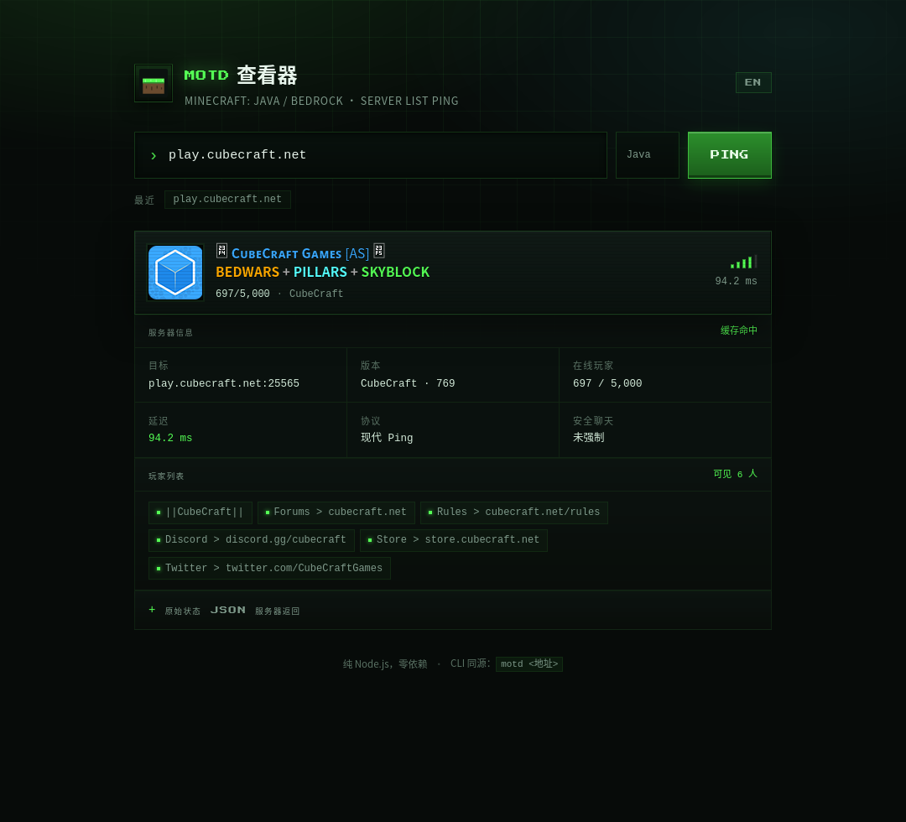
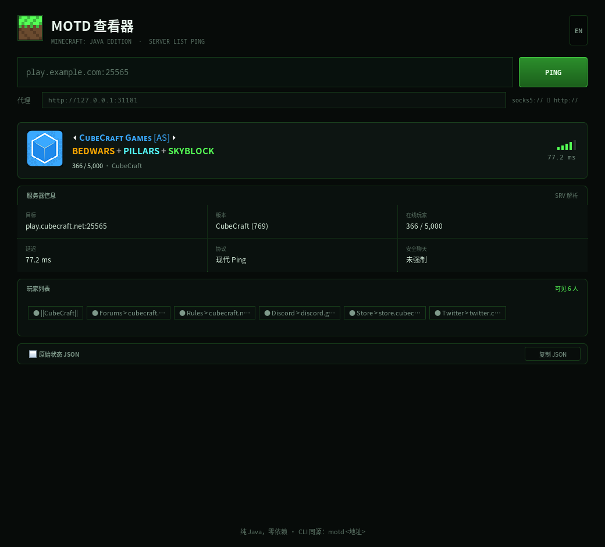

# mc-motd

[中文](README.md) | **English**

A tiny tool for reading **Minecraft Java Edition** server MOTDs — a CLI, a local web UI and a desktop GUI, all built directly on the Server List Ping protocol.

[](https://github.com/must-be-the-Airconditi/mc-motd/actions/workflows/cli.yml)



## Features

- **Direct protocol**: hand-written SLP with the 1.7+ modern handshake and automatic fallback to the legacy 1.6-and-earlier ping
- **Full MOTD rendering**: `§` color codes, `§x` hex colors, bold / italic / underline / strikethrough / obfuscated (animated in the web UI), nested JSON chat components
- **Automatic SRV**: looks up `_minecraft._tcp` when no port is given, matching game-client behavior
- **Server icons**: favicon in the web UI, a colored card in the terminal
- **Proxy support**: `socks5://`, `socks4://`, `http(s)://` for servers you cannot reach directly
- **Web UI**: runs locally, type an address in the browser — history, player list and raw JSON included

## Quick start

The CLI and web UI need Node.js ≥ 18 (no `npm install` required):

```bash
node motd.js play.cubecraft.net
node motd.js play.cubecraft.net:25565 --timeout 8000
node motd.js localhost --proxy http://127.0.0.1:31181   # e.g. DevSidecar / Clash
node motd.js --web                                      # web UI → http://127.0.0.1:8720
```

The desktop app needs Java 11+; grab the installer for your platform from [Releases](https://github.com/must-be-the-Airconditi/mc-motd/releases), or just run:

```bash
java -jar mc-motd-gui.jar
```

Install it as a global command:

```bash
npm link          # then simply: motd <address>
```

## CLI

```
mc-motd 1.0.0 — view Minecraft Java Edition server MOTDs

Usage:
  motd <address...> [options]   query one or more servers
  motd --web                    start the web UI

Options:
  --json           JSON output
  --timeout <ms>   timeout, default 5000
  --proxy <url>    proxy, e.g. http://127.0.0.1:31181 / socks5://127.0.0.1:7890
  --no-srv         skip SRV lookup
  --no-legacy      don't fall back to the legacy ping
  --no-color       disable colors (also honors NO_COLOR)
  --web            start the web UI
  --port <n>       web UI port, default 8720
  --host <h>       bind address, default 127.0.0.1
```

Example output:

```
╭──────────────────────────────────────────────────────────────╮
│ play.cubecraft.net                             ▂▄ 196.2 ms │
│ ···························································· │
│                 ⏴ CᴜʙᴇCʀᴀꜰᴛ Gᴀᴍᴇꜱ [AS] ⏵                     │
│     NEW CUSTOM TRAILS, BEDWARS + PILLARS                     │
│                                                              │
│  742/5000 online  ·  CubeCraft (769)                         │
│  Target play.cubecraft.net:25565                             │
│  Players CubeCraft, Forums > cubecraft.net, …                │
╰──────────────────────────────────────────────────────────────╯
```

JSON mode plays nicely with scripts:

```bash
node motd.js --json play.cubecraft.net | jq '.results[0].players'
```

## Web UI

```bash
node motd.js --web            # http://127.0.0.1:8720 by default
node motd.js --web --port 9000 --proxy socks5://127.0.0.1:7890
```

Browsers do not expose raw TCP sockets, so the page calls a local `/api/ping` endpoint and Node makes the connection:

```
GET /api/ping?address=play.cubecraft.net&timeout=5000&proxy=http://127.0.0.1:31181
```

The server only listens on `127.0.0.1`, rate-limits to 40 requests per minute and caches results for 20 seconds; recent addresses are stored in the browser's localStorage.

## Desktop GUI

A native Java Swing window (not a web page); one codebase runs on macOS / Windows / Linux / BSD.



| Platform | Download |
|---|---|
| Windows x64 | `mc-motd-*-windows-x64.zip` (unzip and run `mc-motd.exe`) |
| Linux x64 | `mc-motd-*-linux-x64.tar.gz` |
| macOS / BSD / others | `mc-motd-*-portable.zip` or `mc-motd-gui.jar` (Java 11+) |

The builds are unsigned: on macOS, right-click → Open the first time; on Windows, pick "More info → Run anyway" in SmartScreen.

Features: server card (favicon / two-line MOTD / player count / latency bars), details, player list, raw JSON, query history and a proxy field.

Building from source only needs a JDK:

```bash
bash gui/build.sh
java -jar gui/dist/mc-motd-gui.jar
```

See [gui/README.md](gui/README.md) for more.

## Can't connect?

- Server offline / wrong port: double-check the address and port; the default is 25565
- Some overseas servers (e.g. Hypixel) time out from certain networks: use a proxy via `--proxy`, or pass `proxy` to the web API
- Java Edition only; Bedrock uses UDP 19132 and a different protocol

## Offline testing

The repo ships a fake server, so you can test the protocol, rendering and web UI with no network at all:

```bash
node tools/mock-server.js            # modern protocol on 25565
node tools/mock-server.js --legacy   # legacy protocol
node tools/mock-server.js --port 25566 --bot   # both

node motd.js localhost:25565
```

Run the tests:

```bash
npm test        # node --test, 17 cases covering protocol, parsing, proxy and web API
```

## Project layout

```
motd.js               CLI entry (argument parsing, terminal rendering)
src/slp.js            SLP: VarInt, framing, modern/legacy ping, SRV
src/proxy.js          SOCKS5 / SOCKS4 / HTTP CONNECT tunnelling
src/motd.js           chat components & § codes, ANSI / frontend segments, normalization
src/web.js            HTTP server + /api/ping
public/               web UI front end (no build step)
gui/                  desktop app (Java Swing, see gui/README.md)
tools/mock-server.js  fake server (generates its favicon in code)
test/run.test.js      node:test cases
.github/workflows/    cli (Node test/release) + gui (Java packaging)
```

## Protocol notes

1. Connect TCP to `host:port`
2. Send Handshake: `packetId=0x00`, protocol version, address, port, nextState=1
3. Send Status Request: `0x00`
4. Receive a VarInt length prefix + `packetId=0x00` + JSON (version / players / description / favicon)
5. Legacy: send `0xFE 0x01` and receive `0xFF` + length + a UTF-16BE string

## Release conventions

Two lines ship independently, with different tag prefixes:

- **CLI / web UI (Node)**: tag `cli-vX.Y.Z`, triggers the `cli` workflow, publishes an npm tarball once tests pass
- **Desktop GUI (Java)**: tag `gui-vX.Y.Z`, triggers the `gui` workflow, builds Windows / Linux packages + a universal jar + a portable zip

The pre-split tags `v1.0.0` (CLI / web) and `v1.1.0` (GUI) remain valid as historical releases.

## License

MIT. The pixel font [Press Start 2P](https://fonts.google.com/specimen/Press+Start+2P) used by the web UI is licensed under the SIL Open Font License 1.1.
