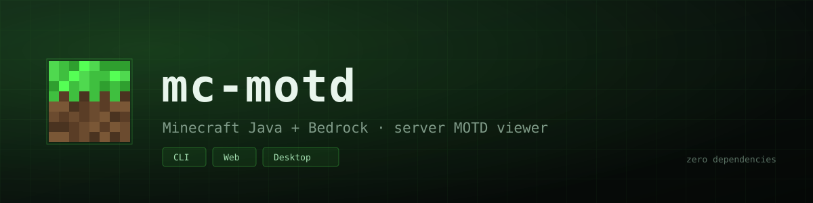
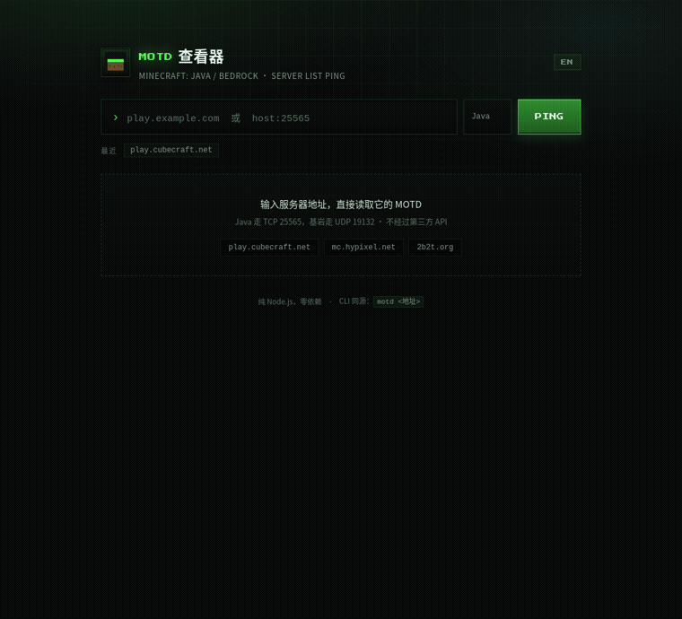
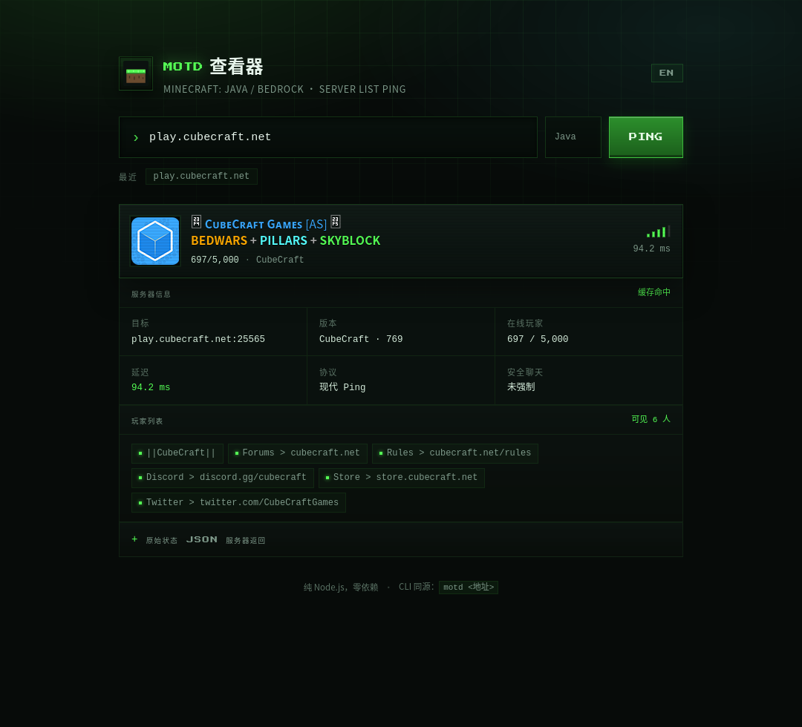
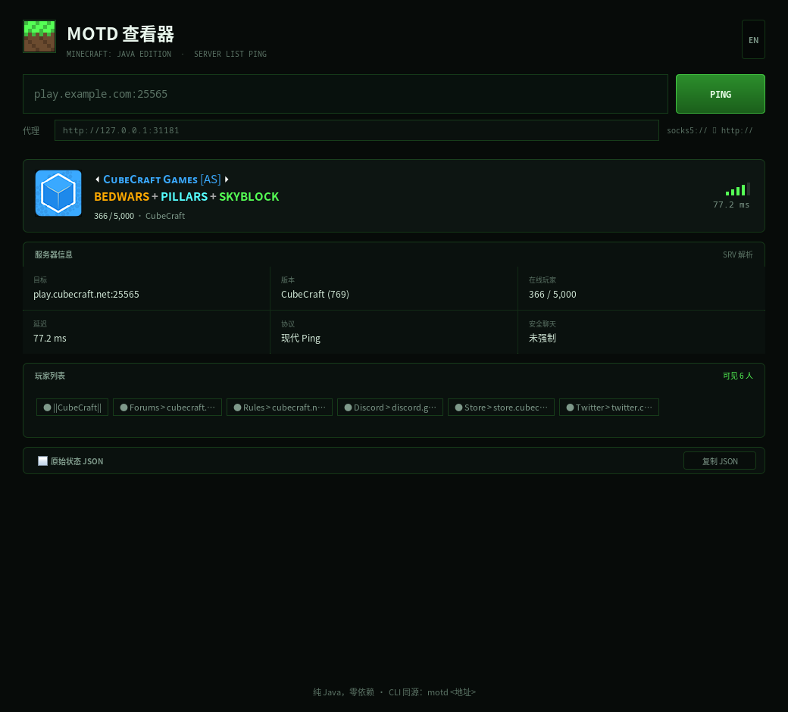

<p align="center">
  
</p>

<p align="center">
  <a href="https://github.com/must-be-the-Airconditi/mc-motd/actions/workflows/cli.yml"></a>
  <a href="https://github.com/must-be-the-Airconditi/mc-motd/releases"></a>
  
  
  
</p>

<p align="center">
  <b>简体中文</b> &nbsp;·&nbsp; <a href="README.en.md">English</a>
</p>

<p align="center">
  看 Minecraft <b>Java 版</b>服务器 MOTD 的小工具：命令行、本地网页版、桌面 GUI 三种形态，<br />
  直接实现服务器列表 Ping（Server List Ping）协议，零运行时依赖。
</p>

---

<details>
<summary><b>目录</b></summary>

- [特性](#特性)
- [截图](#截图)
- [快速开始](#快速开始)
- [命令行](#命令行)
- [网页版](#网页版)
- [桌面版 GUI](#桌面版-gui)
- [连不上怎么办](#连不上怎么办)
- [离线自测](#离线自测)
- [项目结构](#项目结构)
- [协议备忘](#协议备忘)
- [发版约定](#发版约定)
- [许可](#许可)

</details>

## 特性

| | 能力 | 说明 |
| :---: | --- | --- |
| 🔌 | **直连协议** | 手写 SLP，1.7+ 现代协议 + 1.6 及以前自动回退 |
| 🎨 | **MOTD 渲染** | `§` 颜色码、`§x` 十六进制、粗体/斜体/下划线/删除线/乱码、JSON 组件嵌套 |
| 🌐 | **自动 SRV** | 没写端口时查 `_minecraft._tcp`，和游戏客户端行为一致 |
| 🖼 | **服务器图标** | 网页显示 favicon，桌面端显示成图标 |
| 🔀 | **代理** | `socks5://`、`socks4://`、`http(s)://` |
| 💬 | **中英双语** | CLI 与网页版都能切中英文 |
| 🖥 | **三种形态** | 命令行、本地网页、Java 桌面端 |
| 📦 | **零依赖** | Node 只用内置模块，Java 只用标准库 |

## 截图



| 网页版 | 桌面版 |
| :---: | :---: |
|  |  |

## 快速开始

命令行 / 网页版需要 Node.js ≥ 18（无需 `npm install`）：

```bash
node motd.js play.cubecraft.net
node motd.js play.cubecraft.net:25565 --timeout 8000
node motd.js localhost --proxy http://127.0.0.1:31181   # 走 DevSidecar / Clash 等
node motd.js play.cubecraft.net --lang en               # 英文输出
node motd.js --web                                      # 网页版 → http://127.0.0.1:8720
```

桌面版需要 Java 11+，从 [Releases](https://github.com/must-be-the-Airconditi/mc-motd/releases) 下载对应安装包，
或者直接：

```bash
java -jar mc-motd-gui.jar
```

想装成全局命令：

```bash
npm link          # 之后直接用 motd <地址>
```

## 命令行

```
mc-motd 1.2.0 — 看 Minecraft Java 版服务器的 MOTD

用法:
  motd <地址...> [选项]        查询服务器（可一次查多个）
  motd --web                  启动网页版

选项:
  --json           输出 JSON
  --timeout <ms>   超时时间，默认 5000
  --proxy <url>    走代理，如 http://127.0.0.1:31181 / socks5://127.0.0.1:7890
  --no-srv         不解析 SRV 记录
  --no-legacy      现代协议失败时不回退旧版 Ping
  --no-color       关闭颜色（也支持 NO_COLOR 环境变量）
  --lang <zh|en>   输出语言，默认跟随系统
  --web            启动网页版
  --port <n>       网页端口，默认 8720
  --host <h>       网页监听地址，默认 127.0.0.1
```

输出示例：

```
╭──────────────────────────────────────────────────────────────╮
│ play.cubecraft.net                             ▂▄ 196.2 ms │
│ ···························································· │
│                 ⏴ CᴜʙᴇCʀᴀꜰᴛ Gᴀᴍᴇꜱ [AS] ⏵                     │
│     NEW CUSTOM TRAILS, BEDWARS + PILLARS                     │
│                                                              │
│  742/5000 在线  ·  CubeCraft (769)                           │
│  目标 play.cubecraft.net:25565                               │
│  玩家 CubeCraft, Forums > cubecraft.net, …                   │
╰──────────────────────────────────────────────────────────────╯
```

JSON 模式方便接脚本：

```bash
node motd.js --json play.cubecraft.net | jq '.results[0].players'
```

## 网页版

界面支持中文 / English：右上角 `EN` / `中文` 切换，默认跟随浏览器语言，选择会记住（localStorage）。
报错信息由服务端按 `lang` 参数本地化，也会一起切换。

```bash
node motd.js --web            # 默认 http://127.0.0.1:8720
node motd.js --web --port 9000 --proxy socks5://127.0.0.1:7890
```

浏览器没有裸 TCP，所以页面通过本地 `/api/ping` 由 Node 发起连接：

```
GET /api/ping?address=play.cubecraft.net&timeout=5000&proxy=http://127.0.0.1:31181&lang=zh
```

服务只监听 `127.0.0.1`，带 40 次/分钟的限流和 20 秒结果缓存；查询过的地址存在浏览器 localStorage 里。

## 桌面版 GUI

Java Swing 原生窗口，不是网页；一套源码跑 macOS / Windows / Linux / BSD，界面支持中文 / English（跟随系统语言，右上角可切换）。

| 平台 | 下载 |
|---|---|
| Windows x64 | `mc-motd-*-windows-x64.zip`（解压运行 `mc-motd.exe`） |
| Linux x64 | `mc-motd-*-linux-x64.tar.gz` |
| macOS / BSD / 其他 | `mc-motd-*-portable.zip` 或 `mc-motd-gui.jar`（需 Java 11+） |

安装包没有签名：macOS 首次打开要右键 → 打开，Windows SmartScreen 选“仍要运行”。

功能：服务器卡片（favicon / 两行 MOTD / 人数 / 延迟信号条）、详情、玩家列表、原始 JSON、查询历史、代理输入框。

从源码构建只要 JDK：

```bash
bash gui/build.sh
java -jar gui/dist/mc-motd-gui.jar
```

更多见 [gui/README.md](gui/README.md)。

## 连不上怎么办

- 服务器没开 / 端口错：确认地址和端口，默认 25565
- 国内网络到某些海外服（如 Hypixel）会直接超时：用代理，`--proxy` 或在网页请求里带 `proxy` 参数
- 只支持 Java 版；基岩版是 UDP 19132，协议不一样

## 离线自测

仓库里带了一个假服务器，可以完全不联网验证协议、渲染和网页：

```bash
node tools/mock-server.js            # 现代协议，25565
node tools/mock-server.js --legacy   # 旧版协议
node tools/mock-server.js --port 25566 --bot   # 两种都回

node motd.js localhost:25565
```

跑测试：

```bash
npm test        # node --test，21 个用例，覆盖协议、解析、代理、i18n 和网页 API
```

## 项目结构

```
motd.js               CLI 入口（参数解析、终端渲染）
src/slp.js            SLP 协议：VarInt、分帧、现代/旧版 Ping、SRV
src/proxy.js          SOCKS5 / SOCKS4 / HTTP CONNECT 隧道
src/motd.js           聊天组件 & § 码解析、ANSI / 前端片段、结果规范化
src/i18n.js           服务端中英文案
src/web.js            HTTP 服务 + /api/ping
public/               网页版前端（无构建步骤）
gui/                  桌面版（Java Swing，见 gui/README.md）
tools/mock-server.js  假服务器（含代码生成 favicon）
test/run.test.js      node:test 用例
assets/               仓库素材（banner 等）
CHANGELOG.md          版本变更记录
RELEASING.md          发版流程
.github/workflows/    cli（Node 测试/发布）+ gui（Java 打包）+ codeql
```

## 协议备忘

1. TCP 连上 `host:port`
2. 发 Handshake：`packetId=0x00`、协议号、地址、端口、nextState=1
3. 发 Status Request：`0x00`
4. 收 VarInt 长度前缀 + `packetId=0x00` + JSON（version / players / description / favicon）
5. 旧版：直接发 `0xFE 0x01`，收 `0xFF` + 长度 + UTF-16BE 字符串

## 发版约定

两条线独立发布，tag 前缀不同：

- **CLI / 网页版（Node）**：打 `cli-vX.Y.Z`，触发 `cli` 工作流，测试通过后自动发布 npm tarball
- **桌面 GUI（Java）**：打 `gui-vX.Y.Z`，触发 `gui` 工作流，自动打 Windows / Linux 安装包 + 通用 jar + portable 包

拆分前的旧 tag `v1.0.0`（CLI / 网页）和 `v1.1.0`（GUI）仍有效，作为历史版本保留。

具体步骤见 [RELEASING.md](RELEASING.md)，改动记录见 [CHANGELOG.md](CHANGELOG.md)。原则是**攒一批再发**，不按提交发版。

## 许可

MIT。网页里的像素字体 [Press Start 2P](https://fonts.google.com/specimen/Press+Start+2P) 为 SIL Open Font License 1.1。

---

如果这个小工具帮到你，点个 ⭐ 能让更多人找到它。
