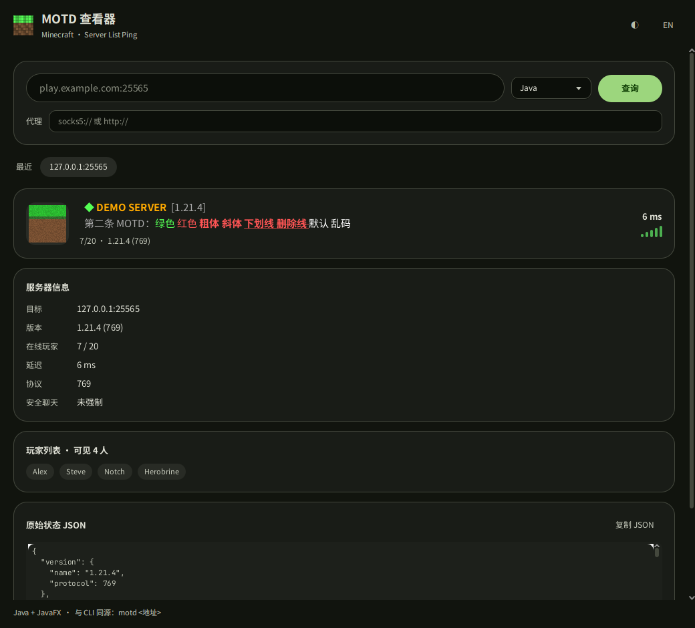

# mc-motd GUI

桌面版：JavaFX 原生窗口，Material 3 风格（跟随系统明暗、草绿主色），不是浏览器页面。同一份源码在 macOS / Windows / Linux / BSD 上运行，支持 **Java / 基岩版**（地址框右侧切换）。



## 运行

需要 Java 17+ 和 JavaFX 21。下载页里的 `linux-x64.tar.gz` / `windows-x64.zip` / `macos-arm64.zip` 自带运行时和 JavaFX，解压直接运行；`portable.zip` 里放了 `javafx/` 目录，用自带的 `mc-motd`（Windows 为 `mc-motd.bat`）启动，只需系统里有 Java 17+：

```bash
./mc-motd                              # portable 包
java --module-path javafx --add-modules javafx.controls -jar mc-motd-gui.jar
java --module-path javafx --add-modules javafx.controls -jar mc-motd-gui.jar play.cubecraft.net
```

## 语言

界面支持中文 / English：

- 默认跟随系统语言（`zh*` → 中文，其余 → English）
- 右上角 `EN` / `中文` 按钮可随时切换，选择会记住
- 也可以强制指定：`-Dmcmotd.lang=en`，或环境变量 `MC_MOTD_LANG=en`

## 从源码构建

需要 JDK 17+（推荐 21）。JavaFX 的 jar 不随 JDK 提供，第一次构建先下载（默认阿里云镜像，可用 `JAVAFX_MIRROR` 换成 Maven Central）：

```bash
bash gui/fetch-javafx.sh
bash gui/build.sh
java --module-path gui/.javafx/lib --add-modules javafx.controls -jar gui/dist/mc-motd-gui.jar
```

`fetch-javafx.sh` 会按系统选 Maven 分类器（linux / linux-aarch64 / mac / mac-aarch64 / win），把 `base`、`graphics`、`controls` 三个 jar（含原生库）放进 `gui/.javafx/lib`。构建脚本用 `javac --release 17` 编译、`jar` 打包成可执行 jar。

想双击就能开（不用手写 `--module-path`）：

```bash
bash gui/build.sh --fat
```

会额外生成 `gui/dist/mc-motd-gui-fat.jar`，把 JavaFX 的类和原生库一起打进去，双击即可运行（仍需系统里有 Java 17+）。`--fat` 只含本机平台的原生库，跨平台发行还是用安装包或 `portable.zip`。

## 生成图标

```bash
java --module-path gui/.javafx/lib --add-modules javafx.controls \
  -jar gui/dist/mc-motd-gui.jar --icon gui/icon.png
node gui/tools/png-to-ico.js gui/icon.png icon.ico   # Windows 用
```

macOS 的 `.icns` 由 CI 里的 `sips` + `iconutil` 生成。

## 打包成安装包

打 `gui-vX.Y.Z` 的 tag 会触发 `gui` 工作流，在 GitHub Actions 的原生 runner 上跑 `jpackage`：

| 平台 | 产物 |
|---|---|
| Linux | `mc-motd-<版本>-linux-x64.tar.gz` |
| Windows | `mc-motd-<版本>-windows-x64.zip`（含 `mc-motd.exe`） |
| macOS（Apple Silicon） | `mc-motd-<版本>-macos-arm64.zip` 或 `mc-motd-<版本>.dmg` |
| macOS（Intel）/ BSD | `mc-motd-<版本>-portable.zip`（自带 `javafx/`）或 `mc-motd-gui.jar` |

JavaFX 不在 JDK 里，所以 jpackage 之后要把 JavaFX 的 jar 放进 app-image 的 `app/javafx/`，启动参数用 `--java-options '--module-path $APPDIR/javafx --add-modules javafx.controls'`。本地手动打包：

```bash
jpackage --type app-image --name mc-motd \
  --input gui/dist --main-jar mc-motd-gui.jar --main-class mcmotd.Main \
  --app-version 1.4.0 --icon gui/icon.png --dest release \
  --java-options "-Dfile.encoding=UTF-8" \
  --java-options '--module-path $APPDIR/javafx --add-modules javafx.controls'
mkdir -p release/mc-motd/lib/app/javafx
cp gui/.javafx/lib/*.jar release/mc-motd/lib/app/javafx/
```

## 无头截图

CI 或本地验证界面时不需要人盯着窗口：`--shot` 会在 JavaFX 里把界面渲染成 PNG（不创建窗口，输出宽度高度固定）：

```bash
java --module-path gui/.javafx/lib --add-modules javafx.controls \
  -jar gui/dist/mc-motd-gui.jar --shot shot.png play.cubecraft.net 1040 940
```

查询失败时会渲染错误态；`-Dmcmotd.dark=true|false` 强制明暗，`-Dmcmotd.lang=en` 强制语言。

## 结构

```
src/mcmotd/App.java      界面：MD3 布局、卡片、详情、玩家、原始 JSON、历史、主题
src/mcmotd/app.css       Material 3 颜色 role 与控件样式
src/mcmotd/Main.java     入口、参数解析、图标 / 截图模式
src/mcmotd/Shot.java     离屏渲染截图
src/mcmotd/Icon.java     图标绘制
src/mcmotd/Slp.java      SLP 协议：VarInt、握手、旧版回退、SRV、代理
src/mcmotd/Bedrock.java  RakNet 基岩版 ping
src/mcmotd/Json.java     极简 JSON 解析
src/mcmotd/Motd.java     § 颜色码 / 十六进制色 / 组件拍平
src/mcmotd/Info.java     查询结果结构化
src/mcmotd/Strings.java  中英文文案
```
