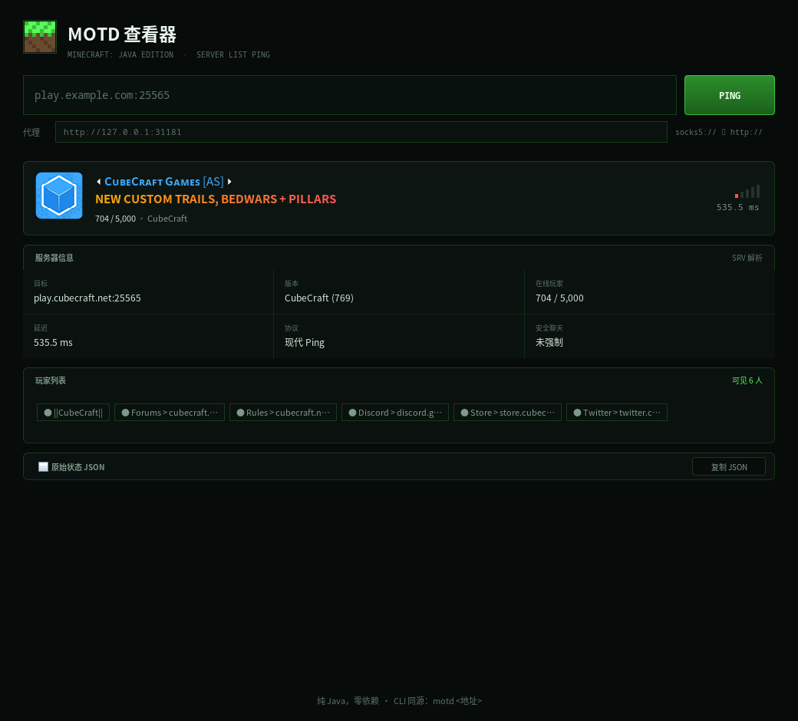

# mc-motd GUI

桌面版：Java Swing 原生窗口，不是浏览器页面。同一份源码在 macOS / Windows / Linux / BSD 上运行。



## 运行

需要 Java 11 或更高版本：

```bash
java -jar mc-motd-gui.jar
java -jar mc-motd-gui.jar play.cubecraft.net   # 启动后直接查这个地址
```

## 从源码构建

只依赖 JDK（11+），不需要 Gradle/Maven，也不会下载任何东西：

```bash
bash gui/build.sh
java -jar gui/dist/mc-motd-gui.jar
```

构建脚本做两件事：`javac --release 11` 编译、`jar` 打包成可执行 jar。

## 生成图标

```bash
java -jar gui/dist/mc-motd-gui.jar --icon gui/icon.png
node gui/tools/png-to-ico.js gui/icon.png icon.ico   # Windows 用
```

macOS 的 `.icns` 由 CI 里的 `sips` + `iconutil` 生成。

## 打包成安装包

GitHub Actions 的三个原生 runner 分别跑 `jpackage`：

| 平台 | 产物 |
|---|---|
| Linux | `mc-motd-1.1.0-linux-x64.tar.gz` |
| Windows | `mc-motd-1.1.0-windows-x64.zip`（含 `mc-motd.exe`） |
| macOS | `mc-motd-1.1.0-macos-{x86_64,arm64}.dmg` |

在 `bash gui/build.sh` 之后本地也可以手动打包：

```bash
jpackage --type app-image --name mc-motd \
  --input gui/dist --main-jar mc-motd-gui.jar --main-class mcmotd.Main \
  --app-version 1.1.0 --icon gui/icon.png --dest release
```

## 无头截图

CI 或本地验证界面时不需要显示器：

```bash
java -Djava.awt.headless=true -jar gui/dist/mc-motd-gui.jar \
  --shot shot.png play.cubecraft.net 1040 940
```

## 结构

```
src/mcmotd/Main.java   入口、深色 L&F、窗口、截图/图标模式
src/mcmotd/Ui.java     界面：卡片、详情、玩家、原始 JSON、历史
src/mcmotd/Slp.java    SLP 协议：VarInt、握手、旧版回退、SRV、代理
src/mcmotd/Json.java   极简 JSON 解析
src/mcmotd/Motd.java   § 颜色码 / 十六进制色 / 组件拍平
src/mcmotd/Info.java   查询结果结构化
src/mcmotd/Theme.java  配色与字体
```
